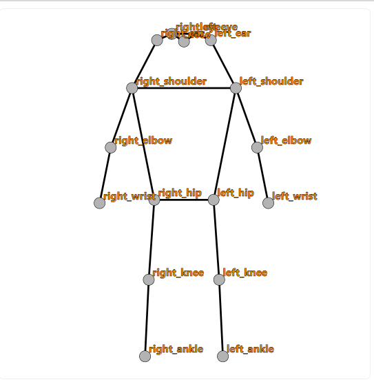
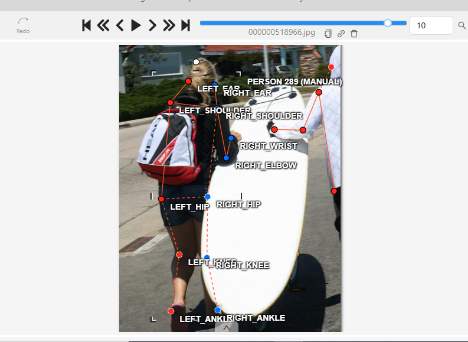
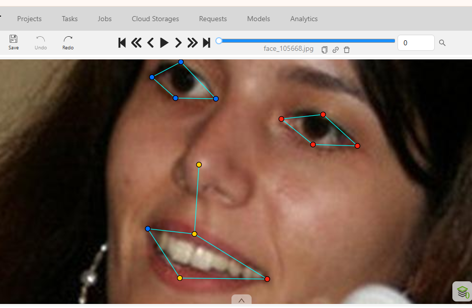
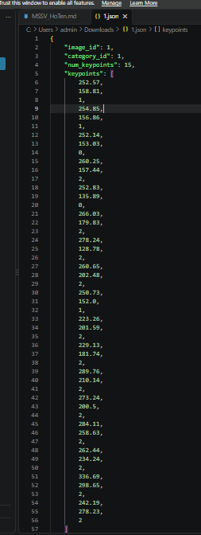

# Báo cáo cá nhân — ViThanhDuc-2A202603051

Đổi tên file theo quy tắc `MSSV_HoTen.md`. Ví dụ: `20241234_NguyenVanAn.md`.

Dữ liệu: 12 ảnh người COCO val2017 (Lin et al., 2014) và 8 ảnh chân dung Wikimedia Commons, chỉ dùng trong lớp.

## 0. Thông tin học viên

- Họ tên: Vi Thanh Đức
- MSSV: 2A202603051
- Email: 26ai.ducvt2@vinuni.edu.vn
- Link repository: https://github.com/viduc2811/K5-L2A-DAY04-ViThanhDuc-2A202603051-KeypointPose
- Phiên bản CVAT (Help → About): 2.74.1
- Máy: hệ điều hành _windows 10__ · RAM _8__ GB · chạy CVAT chế độ đầy đủ
- Bộ ảnh (`src/exports/assignment.json` do `lab.py setup` tạo): có
- Giờ bắt đầu: 17:17 ngày 12/11
- Giờ kết thúc: 18:50 ngày 12/11 (lúc này gán xong label, chưa viết báo cáo). Có sửa lại và hoàn thành báo cáo 10:21 ngày 13/11

## 1. Kiểm tra label (CP0)

| Label | Kiểu | Số điểm | Tên điểm đúng bảng của lab? | Đúng thứ tự? | Số cạnh |
|---|---|---:|---|---|---:|
| `person` |Skeleton |17 |Có |Có |19 |
| `face` |Skeleton |13 |Có |Có |13 |

Mẫu `person` dựng theo người quay mặt về camera (các điểm `left_*` nằm bên phải khung mẫu)? Có

Cách đổi cờ `occluded` / `outside` cho **một điểm** trên phiên bản CVAT này (một câu):
Rê chuột vào điểm rồi bấm `Q` để bật/tắt `occluded` (`v = 1`) hoặc `O` để bật/tắt `outside` (`v = 0`); cũng có thể bấm chuột phải vào điểm và chọn trong menu.

## 2. Số lượng đã gán và thời gian (CP1, CP2)

| Nhóm ảnh | Số ảnh | Số skeleton đã gán | Số người dưới 60 px (không gán) | Số poster / gương / màn hình bỏ qua | Thời gian (phút) |
|---|---:|---:|---:|---:|---:|
| `easy` | 5 |5 |0 |0 |20 |
| `occluded` | 3 |6 |0 |0 |15|
| `back` | 2 |4 |0 |0 |15 |
| `small` | 1 |4 |0 |0 |7 |
| `crowd` | 1 |3 |3 |0 |14 |
| `faces` | 8 |8 | 0 |0|20 |

- Số ảnh người đã xong ở mốc phút 105: _12__ / 10
- Thời gian thực tế (phút): CP1 __71_ · CP2 _20__ · CP3 _25__
- Ảnh tốn thời gian nhất là ảnh nào, vì sao?
 Ảnh tốn thời gian nhất là ảnh đoàn tàu chở người 000000572411.jpg vì phải gán skeleton cho nhiều người, ảnh mờ khó xác định và có nhiều trường hợp occluded và outside

...

## 3. Bảng ca khó (CP1, CP2)

Mỗi điểm bạn phân vân một dòng, nhất là phân vân giữa `v = 1` và `v = 0`, hoặc không chắc hướng người.

| Ảnh | Người / mặt | Điểm | Cờ đã chọn | Phân vân giữa | Lý do chọn |
|---|---|---|---:|---|---|
|000000518966.jpg | người quay lưng, đeo balo|`left_elbow`, `left_wrist` |`v = 0`| `v = 1` / `v = 0`| Tay trái nằm sau balo, không ước lượng chắc vị trí nên chọn `outside`|
|000000176000.jpg | người trượt ván|`left_ankle` |  1|`v = 1` / `v = 2` |Cổ chân trái bị ván và khối đen che nhưng suy ra được từ ống quần nên chọn `occluded` |
|face_13874.jpg |kính râm tối |các điểm mắt |1 |`v = 1` / `v = 2` |Mắt nằm sau tròng kính râm tối nhưng vẫn suy ra được nên chọn `occluded` |

## 4. Bảng tự review (CP3)

Đi từ ảnh cuối về ảnh đầu. 5 ảnh người (ít nhất 2 ảnh `back` hoặc `crowd`) và 3 ảnh mặt. Ít nhất 8 dòng, kể cả dòng `ok`. Ghi lỗi trước, sửa sau.

Mã lỗi dùng đúng một trong: `lr_swap`, `vis_flag`, `position`, `missing`, `extra`, `ok`.

| Ảnh | Người / mặt | Điểm | Mã lỗi | Ghi chú | Đã sửa? |
|---|---|---|---|---|---|
|000000572411.jpg |Người #1, #4 theo id từ thấp đến cao |cả người |`extra` |< 60 px, không đủ điều kiện gán | |
|000000518966.jpg |Người bên phải |cả người |`ok` |Quay lưng, chỉ thấy bên trái, 12 điểm `v = 0` | |
|000000518966.jpg |Người bên trái |cả người |`ok` |`left_*` nằm bên trái ảnh, gối và cổ chân `occluded` | |
|000000461002.jpg |Bé ở xa |hông, gối, cổ chân |`lr_swap` |Bé quay mặt, chân bên trái ảnh là chân phải nhưng đang gán ngược | |
|000000461002.jpg |Bé áo xanh quay lưng |cả người |`ok` |Quay lưng, đúng bên, đường nối không bắt chéo | |
|000000164659.jpg |Người duy nhất trong ảnh |gối, cổ chân |`lr_swap`|Đường hông → gối → cổ chân bắt chéo thành hình chữ X | |
|000000012552.jpg | cầu thủ đánh bóng id bé nhất | vai, cổ tay  | `lr_swap`| cặp shoulder, wrist nằm ngược phía so với các cặp còn lại | |
|face_13874.jpg |Mặt duy nhất |`right_eye_lower` | `vis_flag`|Kính râm tối nhưng điểm này còn `v = 2`, trong khi 7 điểm mắt kia là `occluded` | |
|face_264124.jpg |Mặt duy nhất |cả mặt |`ok` |Mắt phải ở bên trái ảnh, các điểm đúng vị trí | |
|face_10579.jpg |Mặt duy nhất |cả mặt |`ok` |Mắt và khóe miệng đúng bên, mí đặt đúng mép | |

Tổng hợp số lỗi theo mã:

| `lr_swap` | `vis_flag` | `position` | `missing` | `extra` | `ok` |
|---:|---:|---:|---:|---:|---:|
|3 |1 |0 |0 |1 |5 |

Điểm còn phân vân giữa `v = 1` và `v = 0` (ghi cả hai lựa chọn và lý do chọn):
 Tay trái của người quay lưng đeo balo (000000518966, `left_elbow`, `left_wrist`): phân vân giữa `occluded` (`v = 1`) và `outside` (`v = 0`). Chọn `v = 0` vì tay nằm hẳn sau balo, không thấy khớp và không ước lượng chắc vị trí. Nếu đoán bừa với `v = 1` thì điểm sai vẫn bị tính khi huấn luyện.
 Cổ chân trái của người trượt ván (000000176000, `left_ankle`): phân vân giữa `v = 1` và `v = 2`. Chọn `v = 1` vì bị ván và khối đen che nhưng suy ra được vị trí từ ống quần.
 Các điểm mắt của người đeo kính râm (face_13874): phân vân giữa `v = 1` và `v = 2`. Chọn `v = 1` vì mắt nằm sau tròng kính tối nhưng vẫn ước lượng được; riêng `right_eye_lower` ban đầu để sót `v = 2` nên đã ghi ở bảng review là `vis_flag`.


## 5. Kiểm file xuất và kết quả tự kiểm (CP4)

Tự kiểm tay trong file JSON:

| File | Người / mặt kiểm (ảnh, thứ tự) | Số phần tử `keypoints` | Điểm `outside` ra `v = 0`, `occluded` ra `v = 1`? | `num_keypoints` khớp? |
|---|---|---:|---|---|
| `ViThanhDuc_persons.zip` |`000000012552.jpg`, người đầu tiên |51 |Có: `right_eye`, `right_ear` ra `v = 0`; `nose`, `left_eye`, `right_elbow` ra `v = 1` |Có (17 − 2 = 15) |
| `ViThanhDuc_persons.zip` |`000000518966.jpg`, người đầu tiên |51 |Có: 5 điểm `v = 0` (mũi, hai mắt, khuỷu và cổ tay trái), 5 điểm `v = 1` (hông phải, hai gối, hai cổ chân) |Có (17 − 5 = 12)|
| `ViThanhDuc_faces.zip` |`face_13874.jpg` (face duy nhất) |39 |Có: 7 điểm mắt ra `v = 1`, không điểm nào `v = 0` |Có (13) |

Sau khi xuất, CVAT ghi `occluded` thành `v = _1__` và `outside` thành `v = _0__`. Tọa độ của điểm `outside` trong file là `0, 0` hay tọa độ cũ? tọa độ điểm outside là tọa độ cũ

Hai job đã chuyển sang completed trên CVAT? Có

Dán phần **TÓM TẮT** in ra từ `src/check_submission.py`:

```
- File person: ViThanhDuc_persons.zip
  Số ảnh: 12 · số skeleton `person`: 22 · mỗi annotation 51 số
  Skeleton theo ảnh: 000000012552=3, 000000021235=1, 000000157271=2, 000000164659=1, 000000176000=1, 000000225138=1, 000000295358=1, 000000311497=2, 000000393909=2, 000000461002=2, 000000518966=2, 000000572411=4
  Cờ v: v=2 252 (67%) · v=1 45 (12%) · v=0 77 (21%)
  num_keypoints trung bình: 13.5
- File face: ViThanhDuc_faces.zip
  Số ảnh: 8 · số skeleton `face`: 8 · mỗi annotation 39 số
  Skeleton theo ảnh: face_105668=1, face_10579=1, face_13874=1, face_264124=1, face_469647=1, face_496353=1, face_560282=1, face_81239=1
  Cờ v: v=2 97 (93%) · v=1 7 (7%) · v=0 0 (0%)
  num_keypoints trung bình: 13.0
- Ghi chú: 77 điểm v = 0 vẫn mang tọa độ cũ (CVAT 2.x xuất như vậy; chuẩn COCO ghi 0, 0). Không phải lỗi: điểm v = 0 bị bỏ qua khi huấn luyện và khi chấm.
- Số [LỖI]: 0 · số [CẢNH BÁO]: 8
Kết quả: ĐẠT (đọc lại từng cảnh báo ở trên)
```

Các `[CẢNH BÁO]` còn giữ nguyên và lý do:
`000000012552.jpg` người 1 (vai, cổ tay): cầu thủ đánh bóng có tư thế xoắn nên vai và cổ tay theo kiểu quay lưng còn hông, gối theo kiểu quay mặt, chưa kết luận được có phải lỗi đổi trái/phải hay không nên giữ nguyên.
`000000225138.jpg` người 1 (cổ chân): người trượt tuyết đứng nghiêng, hai chân chụm sát và chân trái bị che sau chân phải (đã đặt `occluded`). Chưa có căn cứ rõ để đổi nên giữ nguyên.
`000000311497.jpg` #1 (gối, cổ chân): người chơi tennis đi nhìn nghiêng nên hai chân có thể bắt chéo thật, chưa xác định được chân nào gần camera nên giữ nguyên.
`000000572411.jpg` #2 (cổ tay): người rất nhỏ (cao khoảng 69 px) và ảnh mờ nên không đủ chi tiết để xác định cổ tay nào là trái, phải nên giữ nguyên.

## 6. Ảnh chụp màn hình

1. Label `person` trong label constructor (đủ 17 điểm có tên):

   

2. Một người quay lưng đã gán, cờ đã đặt:

   

3. Một khuôn mặt đã gán 13 điểm, phóng to vùng mắt:

   

4. Một đoạn JSON xuất của một người:

   

Nguồn ảnh: COCO val2017 / Wikimedia Commons.

## 7. Tự đánh giá

1. Lỗi bạn mắc nhiều nhất hôm nay, và cách bạn sẽ tránh ở dự án thật:

   Lỗi mắc nhiều nhất là đổi trái/phải ở phần thân dưới (hông, gối, cổ chân), ví dụ ở ảnh: bé nhỏ ở xa trong ảnh 000000461002. Người quay mặt về camera nhưng chân ở bên trái ảnh lại mang tên `left_*`, nên đường nối hông → gối → cổ chân bắt chéo thành hình chữ X. Và hai skeleton gán cho người cao dưới 60 px ở ảnh 000000572411 (lỗi `extra`). 
   Cách em sẽ tránh ở dự án thật: xác định hướng người trước khi đặt từng nhóm điểm, nhất là chân khi người đứng nghiêng hoặc hai chân chụm sát; nhìn đường nối sau mỗi người, thấy hình chữ X giữa hông và gối là dừng lại kiểm tra; bật hiển thị tên điểm để rà từng cặp trái/phải.

2. Một quy tắc bạn đề xuất thêm vào guideline (kèm ảnh ví dụ nếu có):

   Đề xuất thêm quy tắc cho kính râm tối: nếu tròng kính che mắt thì luôn đặt cả bốn điểm của mắt đó thành `occluded`, không chọn từng điểm một. Ví dụ ảnh face_13874.jpg: bảy điểm mắt đã là `occluded` nhưng `right_eye_lower` còn `v = 2` vì mí dưới trông "nằm sát viền kính". 

3. Nhãn của bạn đi vào model ở đâu? Chọn một lỗi bạn đã sửa và nói nó sẽ làm model học sai thế nào (heatmap, trọng số trong loss, hay bước lật ảnh):

    Nhãn đi vào model theo ba đường: làm mục tiêu heatmap cho từng điểm, làm trọng số trong hàm loss (chỉ điểm có `v > 0` được tính, và khi đánh giá bằng OKS mỗi điểm có sigma riêng), và dùng cho bước lật ảnh ngang (hai kênh trái và phải được đổi chỗ theo danh sách `flip_pairs`). Lấy lỗi `lr_swap` ở chân của bé trong ảnh 000000461002 làm ví dụ: heatmap của `left_knee` và `left_ankle` sẽ được học ở chân bên kia, nên model học rằng "đầu gối trái nằm ở chân phải thật". Khi lật ảnh ngang, hai kênh trái/phải bị hoán đổi nên lỗi này bị nhân đôi theo cả hai hướng. Khi tính OKS, hai điểm này bị coi là sai hoàn toàn dù vị trí điểm nằm đúng trên khớp, vì khoảng cách được tính giữa điểm dự đoán và điểm đúng có cùng tên.

## 8. Khó khăn và lỗi kỹ thuật

 Máy yếu nên chạy docker mất nhiều thời gian

## Bonus (nếu làm)

### B1 — 3 ảnh người khó thêm

| Ảnh | Số skeleton | Số người dưới 60 px | Ca khó nhất |
|---|---:|---:|---|
| | | | |
| | | | |
| | | | |

Kết quả `src/check_submission.py` cho `HoVaTen_bonus_persons.zip`:

```text
(dán ở đây)
```

### B2 — 5 ảnh khuôn mặt đen trắng / hồng ngoại

Ảnh không màu khó hơn ở điểm nào? Kính râm trên ảnh hồng ngoại có còn là `v = 1` không?

...

### B3 — Model so với nhãn của tôi (không tính điểm)

- Demo đã dùng:
- Ảnh đã thử:

1. Model có trả điểm cho khớp bị che, hay khớp ngoài ảnh không? Confidence ở các điểm đó thế nào?

   ...

2. Với người quay lưng, model có đổi trái/phải không?

   ...

3. Bộ điểm của model có giống 17 điểm COCO không?

   ...

## 9. Tài liệu tham khảo và công cụ AI đã dùng

 